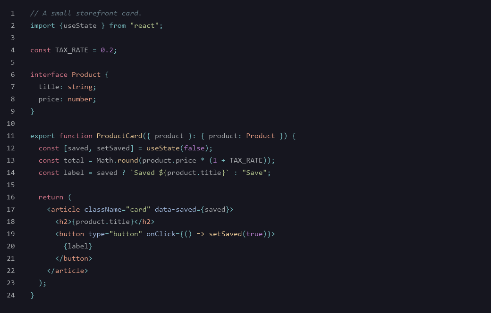
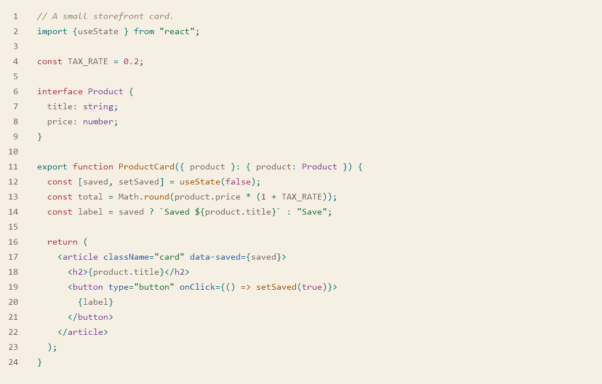

# Depth of Midnight

A dark theme for midnight coding. The background stays deep, the interface keeps a quiet gold, and the syntax stays easy to read.

Depth of Midnight Soft is the same theme with the contrast turned down.

Depth of Midnight Bright Moon is the daylight version. The paper is warm, and the colors stay easy to tell apart.

All three come with the extension. The code in the pictures is [`theme-preview.tsx`](theme-preview.tsx).
